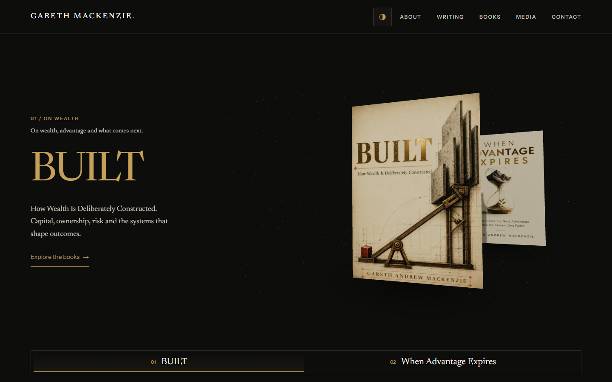
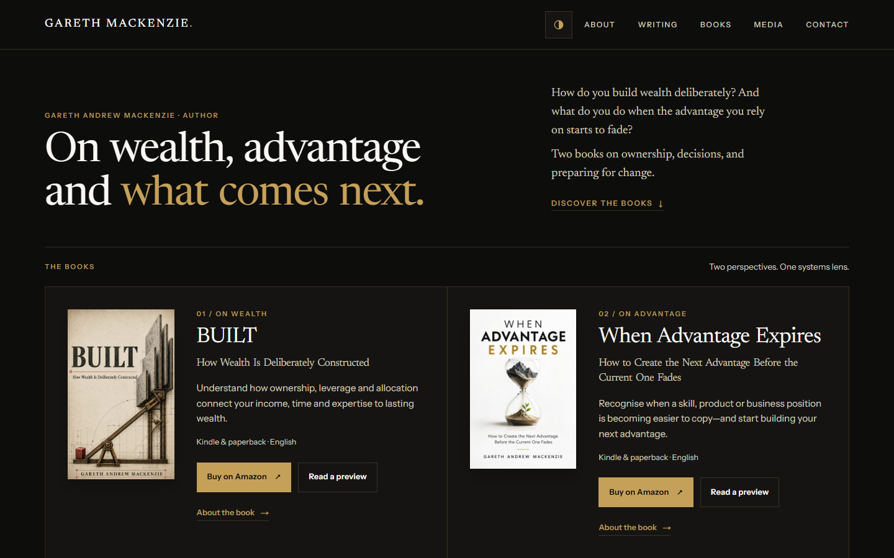
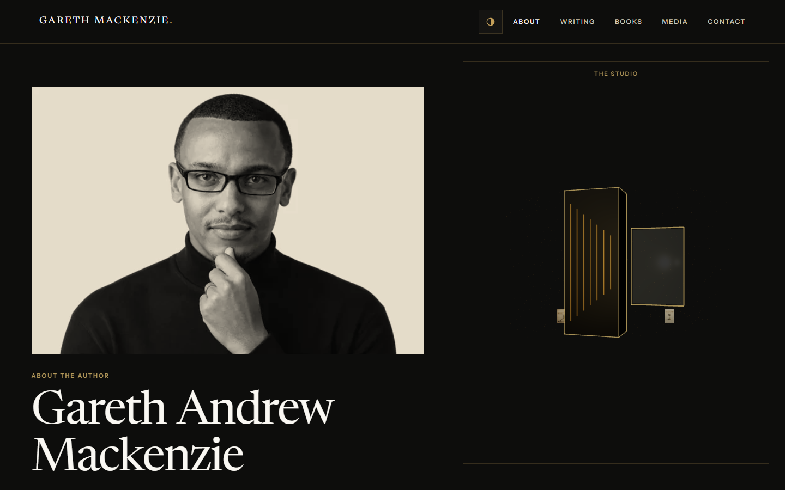
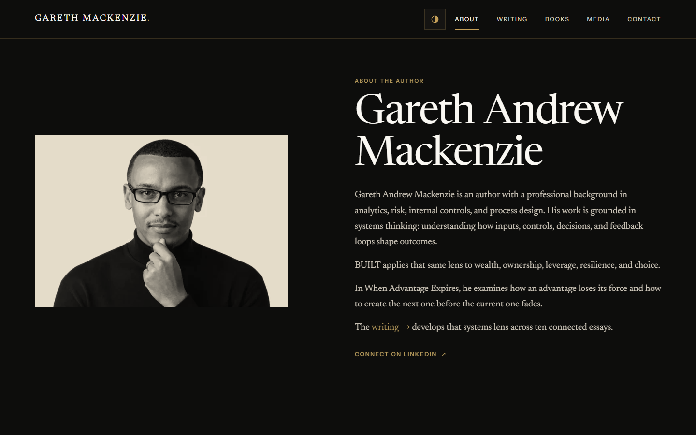
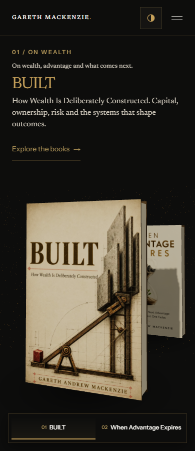
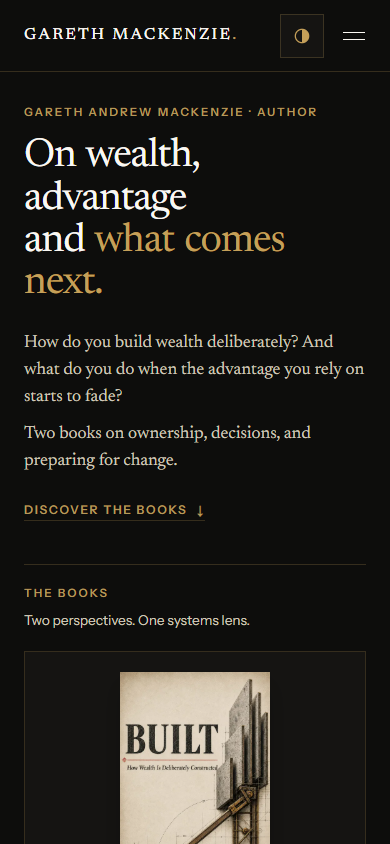
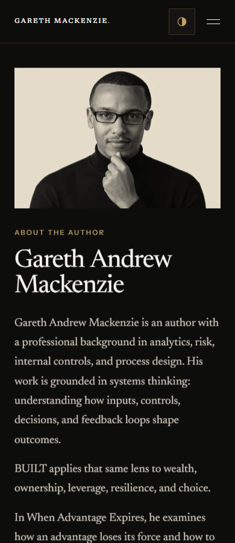
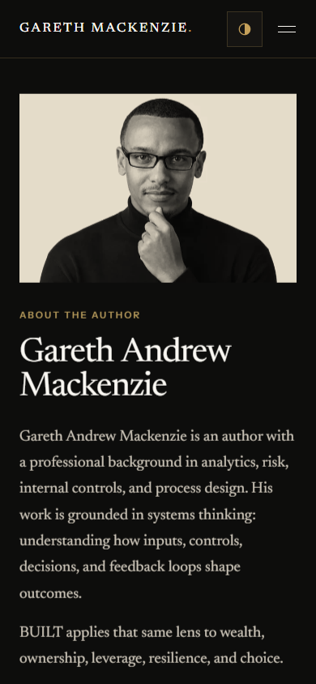
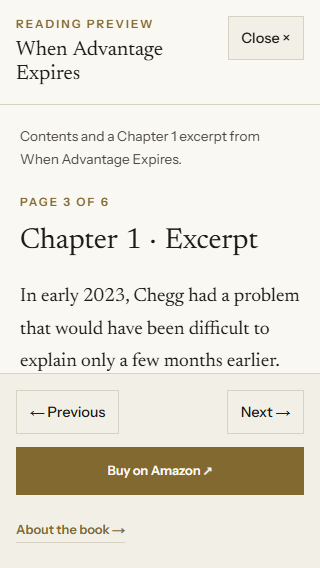

# Editorial redesign validation

## Change and cause

The previous fixed renderer, pinned book states and view-specific scene layouts
reserved space for decorative objects. About became a large studio composition
with small abstract shapes; visitors needed animation states to discover books.
This revision removes that system rather than masking its layout with overrides.

Ordinary documents now share one theme and navigation system. Both books have
fully visible covers and distinct Amazon, preview and detail links. About uses
the existing portrait, biography, professional background and approach. Writing
uses the ten existing essays and static editorial listings. The new native dialog
contains ordinary readable text; inline samples work without JavaScript.

The approved preview data is preserved verbatim. BUILT remains explicitly labelled
as an overview and companion essays. When Advantage Expires retains its verified
contents and Chapter 1 excerpt. Purchase URLs, routes, metadata, consent, form
integration and custom domain are retained.

## Screenshots

Live baseline captures cover every public route at 390, 768 and 1440 pixels.
The full local matrix captures 21 routes at 320, 390, 768, 1024 and 1440 pixels in
both themes. CI uploads these to the editorial-visual-review artifact.

| View | Before | After |
| --- | --- | --- |
| Home, desktop |  |  |
| About, desktop |  |  |
| Home, mobile |  |  |
| About, mobile |  |  |

The replacement reader at 320 × 568:

## Validation

- Source and structure audits pass: 20 content documents, 18 sitemap URLs, local references.
- Production artifact audit passes: 59 files, about 3 MB, 738 references.
- Existing Chromium browser suite passes: 21 routes across seven widths, axe,
  200% text scale, keyboard navigation, no-JavaScript and reduced-motion content,
  portrait framing, consent network gating, contact validation and status semantics.
- Semantic suite passes: static essay sequence, no-JavaScript navigation, 404
  recovery and actual responsive/lazy image resources.
- Expanded editorial suite checks both themes on every route, all six pages of
  each reader, exact preview text, correct purchase links, keyboard containment,
  close/focus restoration, scrollable text, native history and theme persistence.
- CI additionally runs Firefox, WebKit, generated-asset idempotence and unchanged
  Lighthouse budgets (performance 80, accessibility 95, best practices 90, SEO 95).

## Scope and limits

Browser automation does not replace real-device or screen-reader evaluation.
No live contact message or Amazon purchase is submitted. Form semantics and
existing integration are preserved; external fulfilment is outside this test.
The redesigned branch is for review only: it has not been merged or deployed.
